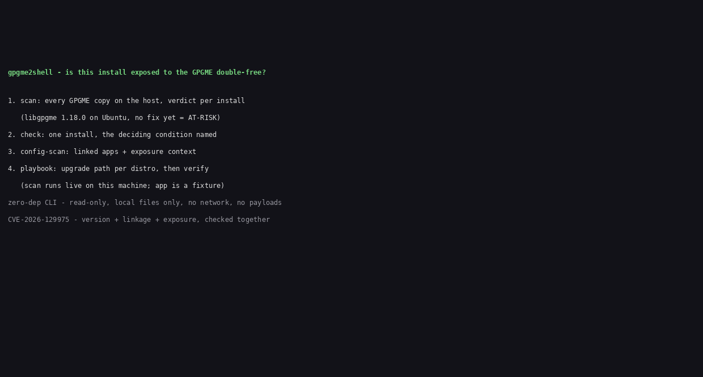

# gpgme2shell

Is this install actually exposed to the GPGME double-free (CVE-2026-129975)?

A zero-dependency TypeScript CLI for operators and CI. It checks the three live conditions together: the installed GPGME version against the 20/11/2026 fixed builds, the linkage type, and the exposure context you declare.

## Why

The flaw is in a C library under the app, not in any package the app owns. `gpg --version` reports the gpg engine (2.4.4 on this machine), not the GPGME library (1.18.0 here) - reading the wrong number is the easiest false SAFE. `pkg-config --modversion gpgme` fails outright when no `.pc` file ships. And a version-only CVE match says "vulnerable" on a box whose only consumer never sees untrusted keys, and says nothing about a static copy no package update can fix.

gpgme2shell runs every version source, reconciles them, and names the condition that decided the verdict.

## Quickstart (install from source)

```sh
git clone https://github.com/techdevfun/gpgme2shell.git
cd gpgme2shell
npm install
npm run build
node dist/cli.js scan
```

No npm package is published yet (pending owner decision on the npm token). Do not install from the registry until the package is published.

## Demo



The GIF is rendered from a real transcript (`demo/transcript.txt`): a live scan of this machine (Ubuntu 24.04, libgpgme 1.18.0, AT-RISK), a check of the Ubuntu package, a check of the fixed 2.3.1 build, a config scan of a fixture mail client, the playbook, and a check of the legacy fixed 1.24.4 build.

## Commands

| Command | What it does |
|---|---|
| `scan [--dirs <dir>...] [--app <dir>] [--no-system] [--json]` | Find every GPGME copy on the host (pkg-config, gpgme-config, dpkg, rpm, ldconfig, lib dirs), read each version, detect linkage, and verdict each install. Also prints the Ghostscript secondary note. |
| `check <version-or-dir> [--linkage shared\|static\|dll] [--exposure trusted\|untrusted\|unknown] [--distro <key>] [--json]` | Verdict for one install. A bare version string works; a directory runs real detection. |
| `config-scan <app-dir> [--json]` | Which apps link GPGME (ldd evidence, Flatpak manifests, build files) and the exposure the operator declared. |
| `playbook [--json]` | First-hour stopgap: upgrade path per platform, static-rebuild note, verification steps, what not to do. |
| `explain <topic>` | Drill-down: CVE-2026-129975, T8557, EXPOSED, AT-RISK, SAFE, UNKNOWN, linkage, distro, ghostscript, versions. |
| `init` | Write `gpgme2shell.config.json` (scan dirs, app dir, exposure and linkage declarations). |

Every command accepts `--json`. Exit codes: 0 SAFE / no EXPOSED, 1 EXPOSED or AT-RISK, 2 UNKNOWN / usage error.

## Verdict rules

- **EXPOSED** - GPGME is in the affected range AND untrusted keys or signed data can reach it (shared/DLL linkage, or a static copy exposed to untrusted input).
- **SAFE** - the installed version is at or above a fixed build: upstream 2.3.1, legacy 1.24.4, or a pinned distro backport (Debian trixie 1.24.2-3+deb13u1, bookworm 1.18.0-3+deb12u1, sid 2.3.1-1, Alpine 3.24 2.3.1-r0).
- **AT-RISK** - affected version but exposure unknown, trusted-only exposure, static linkage needing a vendor rebuild, or a distro with no published fix yet (Ubuntu as of 2026-11-21).
- **UNKNOWN** - unparseable version, 2.3.0 (never publicly available), or a distro build whose backport is not in the pinned table.

A SAFE verdict means these three conditions do not line up - not that the host is safe from every GPGME flaw. The tool never proves exploitability and never sends a crafted key.

## CI gate

```yaml
- run: node dist/cli.js scan --json
```

`scan` exits 1 when any install is EXPOSED or AT-RISK, so it works as a CI gate. Run it on each host after an upgrade and confirm the verdict is SAFE with the fixed build named.

## The vulnerability (checked 2026-11-22)

CVE-2026-129975 (GnuPG tracker T8557), disclosed 20/11/2026 by Werner Koch. A crafted OpenPGP key with a very long user ID triggers a double free in `read_status()` / `read_colon_line()` in `src/engine-gpg.c`. Both functions start with a 1024-byte buffer and realloc on growth, but write the new pointer back to the context only at the end; an early return leaves a stale pointer, freed a second time at release. The advisory says the double free can exfiltrate data from applications by sending signed data, and RCE can't be ruled out. No exploitation in the wild reported as of 2026-11-22. Finder: Johan Carlsson, reported via GitLab 12/11/2026; disclosure pulled forward from 25/11/2026 because GitLab had to update early due to Ruby2Shell. The bug is 24 years old (introduced July 2002, first shipped GPGME 0.3.9).

Fixed in GPGME 2.3.1 (19/11/2026) or legacy 1.24.4 (20/11/2026); Gpg4win 5.1.2 bundles the fix. 2.3.0 was never publicly available. GnuPG published no CVSS for this CVE.

Secondary signal: Ghostscript before 10.08.0 has a -dSAFER bypass (CVE-2026-125396, CVSS 4.0 8.5, VulnCheck), fixed in 10.08.0 (2026-09-08); Debian DLA-4914-1 / DSA-6516-1, Ubuntu USN-8949-1. gpgme2shell reports the installed Ghostscript version as one line in `scan` output. It never drives the verdict.

## Where rivals beat us

- The manual commands (`pkg-config`, `dpkg -l`, `ldd`) and the distro security trackers are the source of truth for the fixed build. This tool only pins what they publish; a distro that ships a fix after 2026-11-22 makes this tool's table stale until it is updated.
- Trivy and Grype cover the whole dependency tree and every CVE at once. gpgme2shell checks only CVE-2026-129975 for its verdict.
- GnuPG's own `gpgme_op_query_swdb` checks the live upstream version database. gpgme2shell is offline by design and never fetches a newer fixed build.
- No dedicated GPGME exposure checker existed when this tool was built (checked 2026-11-22): the alternatives are the manual commands above, the GnuPG library calls for developers, and version-database scanners. That is the gap this tool fills - it does not replace the trackers.

## Honest limits

- Only CVE-2026-129975 drives verdicts. Ghostscript CVE-2026-125396 is a one-line secondary note, not a verdict.
- Exposure is operator-declared. Without a config declaration the verdict is AT-RISK, never silently SAFE.
- A distro suffix not in the pinned table is UNKNOWN. Confirm the backport in the distro security tracker.
- Static linkage can only be declared by the operator or the vendor. The tool cannot see inside a binary that does not expose its linkage.
- The fixed-build table is pinned to 2026-11-22. Check the GnuPG advisory and your distro tracker for newer fixes.

## Roadmap

- More pinned distro backports as vendors publish fixes (Ubuntu first).
- `rpm` and Homebrew detection depth on Fedora/RHEL and macOS hosts.
- A `--watch` mode for fleet scans.

## License

MIT. See [LICENSE](LICENSE).
